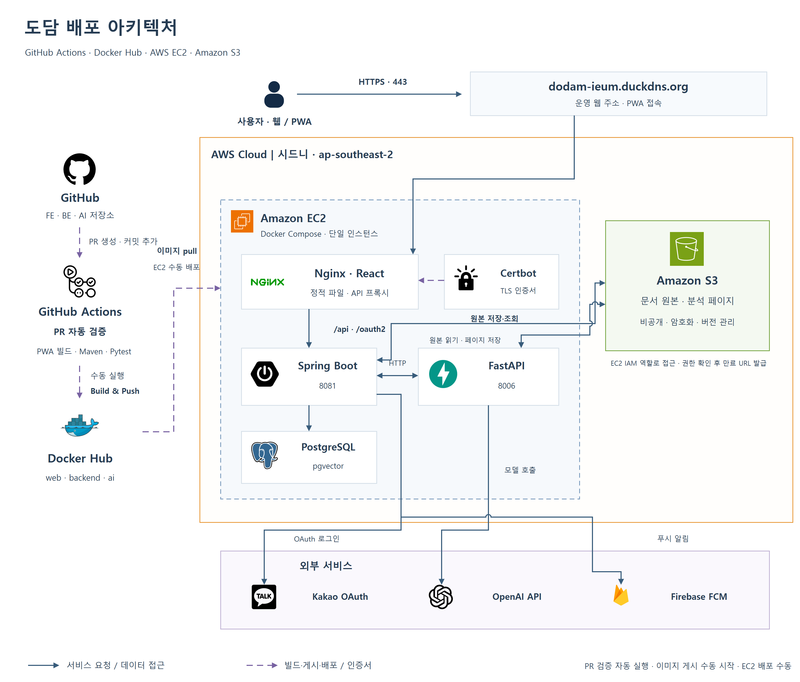

<div align="center">


# 🌿 도담 · Dodam Infrastructure

### 팀 이음의 도담 서비스를 안정적으로 연결하고 운영하는 배포 저장소

[](https://dodam-ieum.duckdns.org/)
[](https://dodam-ieum.duckdns.org/)
[](https://aws.amazon.com/)
[](https://docs.docker.com/compose/)
[](https://aws.amazon.com/about-aws/global-infrastructure/regions_az/)

**React · Spring Boot · FastAPI · PostgreSQL/pgvector · Nginx · Amazon S3**

[🚀 서비스 열기](https://dodam-ieum.duckdns.org/) · [🔎 API 상태 확인](https://dodam-ieum.duckdns.org/api/auth/config) · [⚙️ Actions](https://github.com/ieum-connect/Dodam_infra/actions)

</div>

---

## 한눈에 보기

도담의 프런트엔드, Spring 백엔드, AI 백엔드와 데이터베이스를 **AWS EC2 한 대의 Docker Compose 환경**에서 운영합니다. 외부 요청은 Nginx가 HTTPS로 수신하며, 의료 문서 원본과 분석 페이지는 공개 접근이 차단된 Amazon S3에 저장합니다.

| 구분 | 현재 구성 |
|---|---|
| 운영 주소 | [`https://dodam-ieum.duckdns.org`](https://dodam-ieum.duckdns.org/) |
| 배포 리전 | AWS Sydney · `ap-southeast-2` |
| 실행 환경 | 단일 EC2 · Docker Compose |
| 공개 진입점 | Nginx · HTTPS `443` |
| 애플리케이션 | React PWA · Spring Boot · FastAPI |
| 데이터 | PostgreSQL 16 · pgvector |
| 문서 저장소 | Private Amazon S3 · SSE-S3 · Versioning |
| 인증·외부 연동 | Kakao OAuth · OpenAI API · Firebase FCM |
| 이미지 배포 | GitHub Actions → Docker Hub → EC2 수동 반영 |

> [!NOTE]
> 모바일 브라우저에서 운영 주소에 접속한 뒤 **홈 화면에 추가**하면 PWA로 설치할 수 있습니다. 프런트엔드와 API는 같은 도메인을 사용합니다.

## 아키텍처

<p align="center">
  
</p>

<details>
<summary><strong>🔁 배포 파이프라인 자세히 보기</strong></summary>



```mermaid
flowchart LR
    PR[Pull Request] --> Check[서비스별 빌드·검증]
    Check --> Review[리뷰 및 승인]
    Review --> Dispatch[Release images<br/>수동 실행]
    Dispatch --> SHA[Frontend · Backend · AI<br/>정확한 Commit SHA 고정]
    SHA --> Build[linux/amd64 이미지 빌드]
    Build --> Hub[(Docker Hub)]
    Hub --> Digest[Digest · Revision 검증]
    Digest --> EC2[EC2 이미지 반영]
    EC2 --> Deploy[deploy.sh]
    Deploy --> Verify[Health · Nginx · API 검증]
```

- Pull Request에서는 변경된 Docker/스토리지 구성을 자동 검증하며 이미지를 게시하지 않습니다.
- 운영 릴리스는 `main` 브랜치의 `workflow_dispatch`에서 세 저장소의 40자리 commit SHA를 명시해 실행합니다.
- 게시 이미지의 digest와 revision label을 확인한 뒤 EC2에 반영합니다.
- EC2에서는 소스를 빌드하지 않고 검증된 불변 이미지만 실행합니다.

</details>

<details>
<summary><strong>🧩 서비스와 포트 구성</strong></summary>

| 서비스 | 역할 | 컨테이너 포트 | 외부 공개 |
|---|---|---:|:---:|
| `web` | React 정적 파일 제공, API 프록시, TLS 종단 | `80`, `443` | ✅ |
| `backend` | 인증, 사용자·가족·일정·문서 API | `8081` | ❌ |
| `ai` | AI 채팅, 문서 분석, 복지 설명 | `8006` | ❌ |
| `postgres` | 관계형 데이터와 벡터 검색 | `5432` | ❌ |
| `certbot` | Let's Encrypt 인증서 발급·갱신 | - | ❌ |

외부에는 Nginx의 `80/443`만 공개합니다. `8081`, `8006`, `5432`는 Docker 네트워크 안에서만 접근합니다. SSH `22`는 운영자 공인 IP로 제한합니다.

</details>

## 저장소 구성

```text
Dodam_infra/
├─ .github/workflows/        # 이미지 릴리스·스토리지 검증 Actions
├─ docker/                   # 서비스별 운영 Dockerfile
├─ nginx/                    # bootstrap / HTTPS / proxy 설정
├─ postgres/                 # pgvector 초기화
├─ scripts/                  # 초기화·배포·상태·백업·S3 전환 스크립트
├─ secrets/firebase/         # Firebase credential 마운트 위치(파일은 미추적)
├─ compose.production.yml    # 운영 Compose 정의
├─ .env.production.example   # 환경 변수 템플릿
├─ DEPLOYMENT_GUIDE.md       # 단계별 배포 가이드
├─ S3_DOCUMENT_STORAGE.md    # 문서 S3 전환·롤백 기록
└─ README.md
```

<details>
<summary><strong>🔗 애플리케이션 저장소</strong></summary>

| 영역 | 저장소 |
|---|---|
| Frontend | [`ieum-connect/Dodam_frontend`](https://github.com/ieum-connect/Dodam_frontend) |
| Backend | [`ieum-connect/Dodam_backend`](https://github.com/ieum-connect/Dodam_backend) |
| AI Backend | [`ieum-connect/Dodam_AI_backend`](https://github.com/ieum-connect/Dodam_AI_backend) |
| Infrastructure | [`ieum-connect/Dodam_infra`](https://github.com/ieum-connect/Dodam_infra) |

</details>

## 로컬에서 실행하기

> Docker Desktop의 Linux 컨테이너와 Python 3가 필요합니다. 로컬 검증은 실제 OpenAI API 호출 없이 동작하도록 격리됩니다.

```powershell
Set-Location C:\dodam\infra
python scripts/init-local.py
docker compose --env-file .env.production.local -f compose.production.yml config --quiet
.\scripts\build.ps1
docker compose --env-file .env.production.local -f compose.production.yml up -d --no-build --wait --wait-timeout 240
```

```powershell
curl.exe -i http://localhost:4280/api/auth/config
curl.exe -I http://localhost:4280/index.html
docker compose --env-file .env.production.local -f compose.production.yml ps
```

<details>
<summary><strong>✅ 로컬 정상 기준</strong></summary>

- `web`, `backend`, `ai`, `postgres`가 모두 `healthy`
- `/api/auth/config`가 `200` JSON 반환
- `/index.html`이 `200`과 `Cache-Control: no-cache` 반환
- 해시가 포함된 JS/CSS만 장기 immutable cache 적용
- `/internal`, 직접 `/api/v1`, 원본 `/local-documents` 접근 차단
- 새 DB의 Flyway migration과 pgvector extension 적용 완료

</details>

<details>
<summary><strong>🧰 자주 쓰는 로컬 점검 명령</strong></summary>

```powershell
docker compose --env-file .env.production.local -f compose.production.yml logs --tail 100 backend
docker compose --env-file .env.production.local -f compose.production.yml logs --tail 100 ai
docker compose --env-file .env.production.local -f compose.production.yml exec -T web nginx -t
docker compose --env-file .env.production.local -f compose.production.yml exec -T postgres `
  psql -U dodam -d dodam -c 'SELECT version, success FROM flyway_schema_history ORDER BY installed_rank;'
```

</details>

## 운영 배포

<details>
<summary><strong>🚢 최초 배포 순서</strong></summary>

1. AWS Sydney 리전에서 EC2, EBS, 보안 그룹과 관리자 SSH 접근을 준비합니다.
2. DNS A 레코드를 EC2의 고정 IPv4로 연결합니다.
3. `.env.production.example`을 복사해 `.env.production`을 만들고 권한을 `600`으로 제한합니다.
4. 검증된 세 애플리케이션 이미지를 EC2에 준비합니다.
5. `NGINX_MODE=bootstrap`으로 최초 HTTP health endpoint만 실행합니다.
6. Certbot webroot 방식으로 인증서를 발급합니다.
7. `NGINX_MODE=https`로 전환하고 Nginx 설정 검사 후 reload합니다.
8. 실제 모바일 기기에서 로그인, PWA 설치, 문서, AI, 푸시 알림을 검증합니다.

상세 절차는 [`DEPLOYMENT_GUIDE.md`](./DEPLOYMENT_GUIDE.md)와 [`EC2_SYDNEY.md`](./EC2_SYDNEY.md)를 따릅니다.

</details>

<details>
<summary><strong>📦 릴리스 이미지 만들기</strong></summary>

GitHub Actions의 **Release images**를 수동 실행합니다.

| 입력 | 설명 |
|---|---|
| `release` | 재사용하지 않는 소문자 릴리스 이름 |
| `web_sha` | Frontend의 40자리 commit SHA |
| `backend_sha` | Backend의 40자리 commit SHA |
| `ai_sha` | AI Backend의 40자리 commit SHA |
| `publish` | Docker Hub 게시 여부 |

게시 완료 후 Actions artifact의 `image-digests.txt`와 각 이미지의 revision을 확인합니다. `latest` 태그만으로 운영 버전을 식별하지 않습니다.

</details>

<details>
<summary><strong>🖥️ EC2에서 배포·상태 확인</strong></summary>

```bash
cd /opt/dodam/infra
bash scripts/deploy.sh .env.production
bash scripts/status.sh .env.production
```

`deploy.sh`는 운영 설정을 생성하고 Compose 구문을 확인한 뒤, 이미 준비된 이미지로 컨테이너를 기동합니다. 이어서 `nginx -t`, reload와 서비스 상태 점검을 수행합니다.

```bash
curl -fsS https://dodam-ieum.duckdns.org/api/auth/config
docker compose --env-file .env.production -f compose.production.yml ps
docker compose --env-file .env.production -f compose.production.yml logs --tail 100 backend
docker compose --env-file .env.production -f compose.production.yml logs --tail 100 ai
```

</details>

<details>
<summary><strong>🔐 HTTPS 인증서 발급·갱신</strong></summary>

```bash
docker compose --env-file .env.production -f compose.production.yml run --rm certbot \
  certonly --webroot -w /var/www/acme \
  -d dodam-ieum.duckdns.org --email <관리자-이메일>
```

발급 성공 후 `NGINX_MODE=https`로 바꾸고 다음 순서로 반영합니다.

```bash
python3 scripts/configure.py .env.production
docker compose --env-file .env.production -f compose.production.yml exec -T web nginx -t
docker compose --env-file .env.production -f compose.production.yml exec -T web nginx -s reload
docker compose --env-file .env.production -f compose.production.yml run --rm certbot renew --dry-run
```

인증서 갱신은 `scripts/renew.sh`가 성공 후 Nginx 구문 검사와 reload까지 수행합니다.

</details>

<details>
<summary><strong>🪣 Amazon S3 문서 저장소</strong></summary>

문서 원본과 분석 페이지는 EC2 로컬 볼륨이 아닌 **비공개 S3 버킷**에 저장합니다.

- Block Public Access 4개 항목 활성화
- Bucket owner enforced
- SSE-S3(`AES256`) 암호화
- 객체 Versioning 활성화
- EC2 IAM Role에 필요한 버킷 권한만 부여
- 브라우저에는 만료 시간이 짧은 presigned URL만 전달
- 마이그레이션 시 전체 파일을 다시 읽어 SHA-256 검증

2026-11-16 운영 전환에서 **20개 파일, 7,888,461 bytes**의 read-back hash 일치가 확인됐습니다. 전환 절차와 롤백 주의사항은 [`S3_DOCUMENT_STORAGE.md`](./S3_DOCUMENT_STORAGE.md)를 참고합니다.

</details>

<details>
<summary><strong>💾 백업과 복구</strong></summary>

```bash
cd /opt/dodam/infra
bash scripts/backup.sh .env.production
```

백업 스크립트는 쓰기 서비스(`web`, `ai`, `backend`)를 잠시 중지하고 다음 항목을 같은 시점에 저장합니다.

- PostgreSQL custom-format dump
- 로컬 호환용 uploads archive
- 실행 이미지 목록
- SHA-256 checksum

> [!WARNING]
> 같은 EC2 안의 `backups/`만으로는 장애 복구가 충분하지 않습니다. 결과물을 암호화해 별도 저장소로 옮기고 복원 테스트까지 완료해야 합니다. 운영 DB 위에서 바로 복원하지 말고 별도 Compose project와 새 volume에서 검증합니다.

</details>

<details>
<summary><strong>↩️ 재배포와 롤백 원칙</strong></summary>

1. 배포 전 DB·문서 백업과 현재 이미지 digest를 기록합니다.
2. 이전 이미지는 새 버전 검증이 끝날 때까지 삭제하지 않습니다.
3. DB가 이전 코드와 호환되는지 확인한 뒤 이미지 버전을 되돌립니다.
4. 이미 적용된 Flyway migration 파일을 수정하거나 제거하지 않습니다.
5. S3 전환 후 새 문서가 S3에만 존재할 수 있으므로 저장소 설정만 `local`로 되돌리지 않습니다.
6. `docker compose down -v`는 운영에서 사용하지 않습니다.

</details>

## 환경 변수

<details>
<summary><strong>⚙️ 필수 설정 그룹 보기</strong></summary>

| 그룹 | 주요 변수 |
|---|---|
| 배포 | `RELEASE_TAG`, `BACKEND_IMAGE`, `AI_IMAGE`, `WEB_IMAGE`, `PLATFORM` |
| 네트워크 | `DOMAIN`, `PUBLIC_ORIGIN`, `BIND_ADDRESS`, `HTTP_PORT`, `HTTPS_PORT`, `NGINX_MODE` |
| 보안 | `POSTGRES_PASSWORD`, `JWT_SECRET`, `AI_INTERNAL_TOKEN`, `COOKIE_SECURE` |
| Kakao | `KAKAO_CLIENT_ID`, `KAKAO_CLIENT_SECRET`, `KAKAO_ADMIN_KEY` |
| AI | `OPENAI_API_KEY`, `LLM_API_KEY`, `EMBEDDING_API_KEY`, `LLM_MODEL`, `EMBEDDING_MODEL` |
| S3 | `DOCUMENT_STORAGE_PROVIDER`, `DOCUMENT_S3_BUCKET`, `DOCUMENT_S3_REGION` |
| FCM | `PUSH_ENABLED`, `FIREBASE_PROJECT_ID`, `FIREBASE_VAPID_KEY`, `FIREBASE_SECRETS_DIR` |
| Demo | `DEMO_LOGIN`, `DEMO_SHOWCASE_ONLY` |

전체 목록과 기본값은 [`.env.production.example`](./.env.production.example)에서 확인합니다.

> [!CAUTION]
> `.env.production`, AWS key, Firebase service account, OAuth secret, API key를 Git에 커밋하지 마세요. `VITE_` 변수에는 브라우저에 노출되면 안 되는 값을 넣지 않습니다.

</details>

<details>
<summary><strong>🤖 AI 모델 기본 설정</strong></summary>

| 용도 | 환경 변수 | 기본값 |
|---|---|---|
| LLM | `LLM_MODEL` | `gpt-6-luna` |
| Vision | `OPENAI_VLM_MODEL` | `gpt-5.6-sol` |
| Embedding | `EMBEDDING_MODEL` | `text-embedding-3-small` |
| Embedding 차원 | `EMBEDDING_DIMENSIONS` | `768` |

운영에서 유효한 키와 모델 접근 권한을 확인한 뒤 배포합니다. 로컬 검증용 가짜 키를 운영 환경에 복사하지 않습니다.

</details>

## 운영 체크리스트

<details open>
<summary><strong>🟢 배포 직후</strong></summary>

- [ ] 네 컨테이너가 모두 `healthy`인지 확인
- [ ] `https://dodam-ieum.duckdns.org/`가 `200`인지 확인
- [ ] `/api/auth/config`가 JSON과 `Cache-Control: no-store`를 반환하는지 확인
- [ ] HTTP가 HTTPS로 `308` redirect 되는지 확인
- [ ] 인증서 도메인과 만료일 확인
- [ ] Kakao 로그인·새로고침 유지·로그아웃 확인
- [ ] PWA 설치와 service worker update 확인
- [ ] 문서 업로드·원본 조회·분석 결과 확인
- [ ] AI 채팅·임베딩·복지 설명 확인
- [ ] FCM 알림 수신·탭 이동·로그아웃 후 수신자 분리 확인
- [ ] 오류 로그에 비밀 값이나 문서 본문이 남지 않는지 확인

</details>

<details>
<summary><strong>🌙 정기 운영</strong></summary>

- [ ] 인증서 갱신 dry-run 및 실제 timer 로그 확인
- [ ] EC2/EBS/공인 IPv4/S3/API 비용 확인
- [ ] 디스크·메모리·컨테이너 재시작 횟수 확인
- [ ] S3 암호화·버전 관리·공개 접근 차단 유지 확인
- [ ] 백업 checksum과 외부 보관 상태 확인
- [ ] 별도 환경에서 DB·문서 복원 테스트
- [ ] 오래된 이미지 정리는 현행·직전 버전 검증 후 수행

</details>

<details>
<summary><strong>🚨 장애 대응 빠른 확인</strong></summary>

| 증상 | 먼저 확인할 항목 |
|---|---|
| `502 Bad Gateway` | `backend`/`ai` health, Docker DNS 서비스명, 애플리케이션 로그 |
| 로그인 redirect 오류 | Kakao Web domain, Redirect URI, `PUBLIC_ORIGIN`, secure cookie |
| DB 인증 실패 | 기존 volume의 실제 비밀번호와 `.env.production` 일치 여부 |
| Flyway 실패 | migration version/checksum, 이미 적용된 파일 변경 여부 |
| 문서 조회 실패 | S3 IAM role, bucket/region, presigned URL 만료, 객체 key |
| AI 기동 실패 | LLM·embedding key, 모델 접근 권한, `AI_INTERNAL_TOKEN` |
| PWA 갱신 안 됨 | `sw.js`/manifest `no-cache`, service worker scope, 브라우저 cache |
| 인증서 발급 실패 | DNS A/AAAA, 보안 그룹 `80`, ACME webroot volume |

</details>

## 보안 원칙

<details>
<summary><strong>🛡️ 운영 보안 기준</strong></summary>

- EC2 Metadata Service는 IMDSv2를 사용합니다.
- SSH는 관리자 공인 IP의 `/32`만 허용합니다.
- DB와 애플리케이션 내부 포트를 인터넷에 공개하지 않습니다.
- 컨테이너 간 AI 호출에는 공유 내부 토큰을 사용합니다.
- API 응답과 인증 관련 경로에는 `no-store`를 적용합니다.
- `/internal`, 직접 `/api/v1`, 로컬 원본 문서 경로는 Nginx에서 차단합니다.
- 운영 secret은 GitHub Secret 또는 제한된 권한의 서버 환경 파일로 관리합니다.
- 로그·백업을 공유하기 전에 secret과 개인정보 포함 여부를 확인합니다.
- S3는 비공개 버킷과 EC2 IAM Role을 사용하며 장기 access key를 서버에 저장하지 않습니다.

</details>

## 관련 문서

<details>
<summary><strong>📚 문서 모음</strong></summary>

| 문서 | 내용 |
|---|---|
| [`DEPLOYMENT_GUIDE.md`](./DEPLOYMENT_GUIDE.md) | 최초 배포부터 HTTPS·PWA 검증까지 단계별 안내 |
| [`EC2_SYDNEY.md`](./EC2_SYDNEY.md) | Sydney 리전 EC2 설정과 사전 확인 |
| [`S3_DOCUMENT_STORAGE.md`](./S3_DOCUMENT_STORAGE.md) | S3 준비·마이그레이션·검증·롤백 |
| [`AUDIT.md`](./AUDIT.md) | 소스와 운영 차단 사항 점검 |
| [`RESULTS.md`](./RESULTS.md) | 로컬·운영 검증 결과 기록 |
| [`도담_배포_가이드라인.html`](./도담_배포_가이드라인.html) | 브라우저용 배포 가이드 |

`planning/`의 Kubernetes 자료는 초기 비교 검토 기록입니다. 현재 운영 아키텍처는 **단일 EC2 + Docker Compose**이며 EKS, ALB, NAT Gateway를 사용하지 않습니다.

</details>

---

<div align="center">

**Team IEUM · 팀 이음**

도담의 배포와 운영 기록은 재현 가능하고, 검증 가능하며, 비밀 값을 포함하지 않아야 합니다.

<sub>Architecture & operations baseline · 2026-11-17</sub>

</div>
